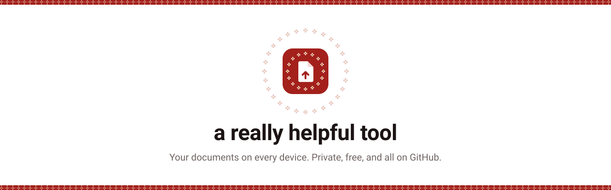
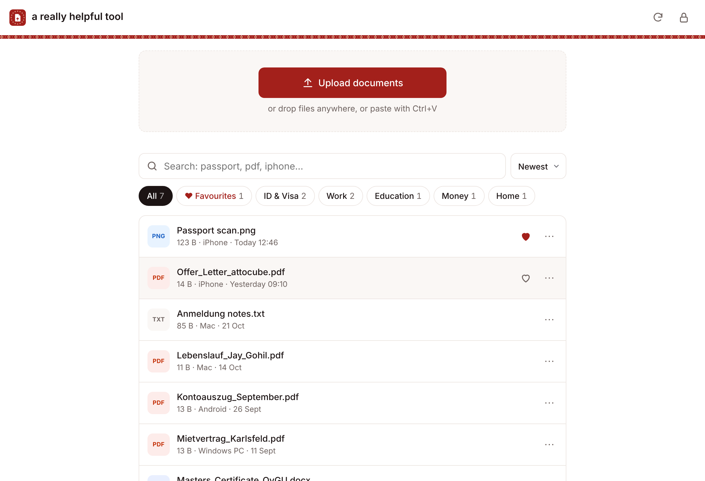
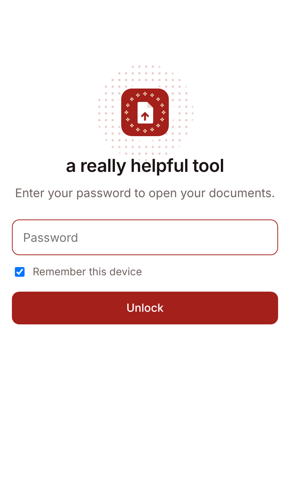
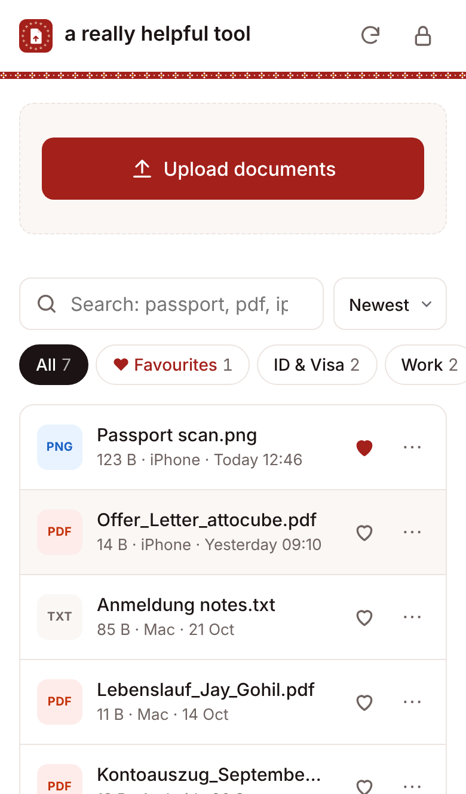
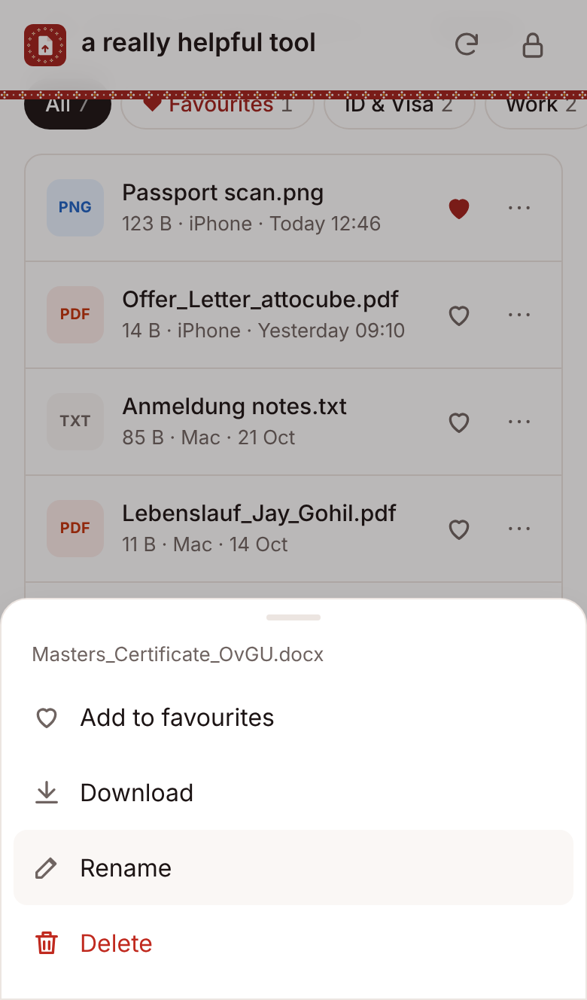

<p align="center">
  
</p>

<p align="center">
  <a href="https://github.com/GermanyMayank/a-really-helphul-tool/actions/workflows/ci.yml"></a>
  
  
  
  <a href="LICENSE"></a>
</p>

<p align="center">
  <b><a href="https://germanymayank.github.io/a-really-helphul-tool/">Open the app</a></b>
  &nbsp;·&nbsp; <a href="docs/SETUP.md">Set it up</a>
  &nbsp;·&nbsp; <a href="docs/ARCHITECTURE.md">How it works</a>
  &nbsp;·&nbsp; <a href="docs/AI_HANDOFF.md">Continue with another AI</a>
</p>

---

A private document locker that lives entirely on GitHub. Open one link on your phone or laptop, type your password once, and your passport scan, CV, contracts and certificates are there: upload, preview, favourite, rename, copy, send, download. Everything syncs to every other device.

No server. No database. No monthly bill. No build step.

<p align="center">
  
</p>

<p align="center">
  
  &nbsp;
  
  &nbsp;
  
</p>

## What it does

| | |
|---|---|
| **Upload from anywhere** | Big upload button on phones, drag and drop anywhere on a laptop, or paste a screenshot with Ctrl+V. Exact duplicates are spotted and skipped. |
| **Sorts itself** | Files land in ID & Visa, Work, Education, Money, Home, Photos or Other, by reading the file name in English and German (*Aufenthaltstitel*, *Mietvertrag*, *Lebenslauf*...). |
| **Finds anything** | Search forgives typos (`pasport`), knows file types (`pdf`, `photo`), devices (`iphone`), categories (`visa`) and dates (`march`, `week`). |
| **Favourites** | Heart a file and it stays at the top, on every device. |
| **Opens instantly** | Tap a PDF, image or text file and it previews at once. Files are cached on the device and start downloading the moment your finger touches them. |
| **Hands files over** | Copy images and text to the clipboard, or send the real file to WhatsApp, Mail or AirDrop with the phone's share sheet. |
| **Forgiving** | Rename in one tap. Deleted by mistake? Undo. Every change is a git commit, so nothing is ever truly lost. |
| **Shows where files came from** | Each file shows the device it was uploaded from and when. |

## How it stays private

```
 Phone / laptop                          GitHub
 ┌─────────────────────┐   HTTPS + key    ┌──────────────────────────────┐
 │ this app            │ ───────────────▶ │ your vault repo  (PRIVATE)   │
 │ (GitHub Pages,      │                  │   files/Passport.pdf         │
 │  public code only)  │ ◀─────────────── │   files/CV.pdf  ...          │
 └─────────────────────┘                  └──────────────────────────────┘
          ▲
          └── your password unlocks the access key, which is stored
              AES-256 encrypted in config.js
```

- The **code** in this repo is public. Your **documents** live in a separate **private** repo that only your key can open.
- The key is a fine-grained GitHub token limited to that one repo. It is stored encrypted (PBKDF2 with 600,000 rounds + AES-256-GCM); without your password it is useless.
- A strict Content Security Policy blocks every script and connection except this site and `api.github.com`. No trackers, no CDNs, no third-party code.
- The lock button wipes the key and every cached file from that device.

Details: [docs/ARCHITECTURE.md](docs/ARCHITECTURE.md) · Reporting a problem: [SECURITY.md](SECURITY.md)

## Set it up (about 10 minutes)

1. Fork or copy this repo. Under **Settings > Pages**, set **Source** to **GitHub Actions**.
2. Create a **private** repo for your documents, e.g. `docsync-vault`.
3. Create a [fine-grained token](https://github.com/settings/personal-access-tokens/new) with access to only that repo and **Contents: Read and write**.
4. Open `https://<you>.github.io/<this-repo>/setup.html`, enter the token, choose a password, copy the result into `config.js` and commit.
5. Open the app on any device and unlock.

Every step, click by click: **[docs/SETUP.md](docs/SETUP.md)**

## For developers

Plain HTML, CSS and JavaScript modules. Read `assets/app.js` top to bottom and you know the app.

```
├── index.html            the app
├── setup.html            one-time setup: encrypts your token into config.js
├── config.js             the only file a user edits
├── assets/
│   ├── app.js            UI, in numbered sections
│   ├── github.js         the only code that talks to GitHub
│   ├── organize.js       categories, search, sorting (pure functions)
│   ├── meta.js           where and when each file was uploaded
│   ├── state.js          synced favourites
│   ├── blobs.js          file cache, prefetch, duplicate check
│   ├── crypto.js         token encryption
│   ├── setup.js          setup page logic
│   └── style.css         all styles and colour tokens
├── scripts/build-site.sh copies the site and cache-busts it for deploy
├── tests/e2e.mjs         ~70 browser checks against a fake GitHub
└── .github/workflows/    test on every push, deploy to Pages when green
```

```bash
npm install && npx playwright install chromium
npm run build && python3 -m http.server 8080 --directory _site &
npm test
```

The tests fake the whole GitHub API, so no token is needed. See [CONTRIBUTING.md](CONTRIBUTING.md).

## Design

White first, with small touches from Saurashtra and Kathiyawad in Gujarat: a thin strip of **bandhani** (the tie-dye dots of Jamnagar), **kumkum** red and **haldi** yellow, and a bandhani ring around the logo. The colours are tokens at the top of `assets/style.css`.

## Roadmap

Expiry reminders for passports and permits, recently opened, notes and tags, multi-select, offline mode. Full list in [docs/AI_HANDOFF.md](docs/AI_HANDOFF.md).

## License

[MIT](LICENSE) © 2026 Jay Gohil
